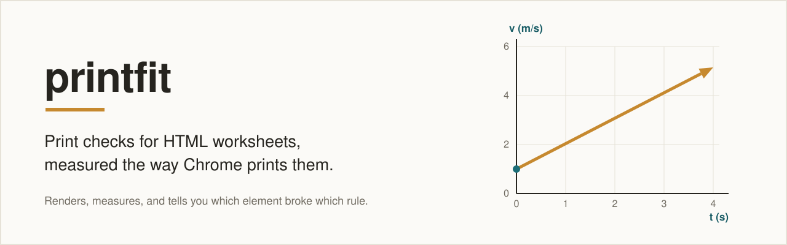

# printfit

<p align="center">
  <picture>
    <source media="(prefers-color-scheme: dark)" srcset="docs/assets/hero-dark.svg">
    
  </picture>
</p>

<p align="center">
  <a href="LICENSE"></a>
  <a href="https://github.com/adamcelove/printfit/actions/workflows/test.yml"></a>
</p>

Part of [Physics Doc Kit](https://github.com/adamcelove/physics-doc-kit), the Claude Code plugin that writes physics worksheets to a standard and uses printfit as its print gate. printfit also works on its own, with any HTML.

Deterministic print checks for HTML worksheets, quizzes, and handouts.

If you write your physics worksheets as HTML and print them, you know the
failure: a figure that quietly doubles in height, a question separated from its
work space by a page break, a graph label that renders at twice the size of the
body text. printfit renders the page the way Chrome will print it, measures it,
and tells you which element broke which rule, with a suggested fix. It can also
fit a document to a page budget by adjusting figure heights and work-space
sizes without touching the content.

## Failing and passing

<p align="center">
  
</p>

Two different documents, real output. Left: `printfit check` on the synthetic `prefix-worksheet.html` fixture, shortened. Right: `printfit check` on the example worksheet in [Physics Doc Kit](https://github.com/adamcelove/physics-doc-kit).

## Why

A worksheet went from 5 pages to 9 because SVGs styled `width:100%; height:auto`
take their height from whatever column they land in. A number line's labels
rendered at 31px beside 14.7px body text because the figure was authored in a
210-unit viewBox and rendered 700px wide. Both satisfied every numeric
constraint in force at the time. Both were caught only by a person looking at
the page. printfit measures those ratios.

One render pass per document: Chrome to PDF, page rasters, and a DOM geometry
dump **with the print stylesheet active**. Every check then reads those
artifacts, so each check is unit-testable against a frozen fixture.

## Requirements

- Python 3.12 or newer and [uv](https://docs.astral.sh/uv/)
- Google Chrome or Chromium

printfit looks for the browser in this order: the `PRINTFIT_CHROME` environment
variable, the standard macOS install locations for Google Chrome and Chromium,
then `google-chrome`, `google-chrome-stable`, `chromium`, and
`chromium-browser` on your `PATH`. If none is found it stops with
`Google Chrome or Chromium not found` and exit code 2. If `PRINTFIT_CHROME`
is set to something that is not an executable file, it stops with an error
naming the bad path rather than falling back silently. To use a specific
browser:

```
export PRINTFIT_CHROME="/path/to/chrome"
```

## Install

```
uv tool install git+https://github.com/adamcelove/printfit
```

Or from a clone: `uv sync`, then prefix commands with `uv run`.

## Quickstart

These commands assume a clone of this repository (the fixtures and profile live
in it, and paths are relative to the repo root). The repo ships two small
synthetic worksheets. The first passes; the second reproduces the classic
regressions.

```
printfit check tests/fixtures/synthetic/fixed-worksheet.html \
    --profile profiles/motion-graphs.yaml

  page 1  fill  62%   slack   368px   OK  (break)
  ...
  all hard gates pass
  verdict: pass

printfit check tests/fixtures/synthetic/prefix-worksheet.html \
    --profile profiles/motion-graphs.yaml

  HARD  auto_height:svg.grid.g-pa
        height derives from the container (width:100%; height:auto) ...
        fix: set an explicit height (<= 2.02in) with width:auto; max-width:100% on svg.grid.g-pa
  ...
  verdict: fail
```

Each run writes `report.json`, `report.html`, the PDF, and page PNGs to
`out/<document name>/`. Run it again after an edit and the report shows only
what changed.

## Hard gates

| Gate | Catches |
|---|---|
| `structural_invariants` | content silently duplicated or lost during automated edits |
| `text_scale` | SVG labels whose realised size drifts from the body typographic scale |
| `figure_height` | figures whose height derives from their container |
| `page_slack` | one-pixel overflow that silently orphans a question |
| `qa_split` | a question separated from its answer space by a page break |
| `aspect_ratio` | a stretched x–t graph, which misrepresents its slope |

`aspect_ratio` and `text_scale` are hard gates despite arriving as aesthetic
complaints: both are exactly computable, and both are ship-blockers on paper.

## CLI reference

### `printfit check <html>`

Render, run every gate, print a report. Exit code 0 on pass, 1 on a hard
failure, 2 on a harness error such as a missing browser.

| Option | Meaning |
|---|---|
| `--profile FILE` | YAML profile saying which CSS classes are graphs, scales, or small multiples, and which are student work space |
| `--out DIR` | output directory (default `out/<document name>`) |
| `--json` | print the machine-readable report instead of text |
| `--diff FILE` | diff against a previous `report.json` (default: the last run of the same document) |
| `--no-diff` | skip the automatic diff |
| `--full` | list every finding, not just new, changed, or regressed ones |
| `--why` | explain each page overflow or underfull page |

### `printfit render <html> [--out DIR]`

Only produce the artifacts: `render.pdf`, `page-N.png`, and `geometry.json`.
Default output directory is `out/render`.

### `printfit fit <html> --out DIR [--profile FILE] [--max-iter N]`

Search for figure heights and work-space sizes that meet the profile's page
budget (`pages:` and `section_pages:`), verify the result with the same gates,
and write `fitted.html` and `fit.json` to `DIR`. Only CSS is changed, and a
structural fingerprint confirms no content was added or lost. Problems that
need the document re-authored, such as a figure drawn in a viewBox so narrow its
text cannot be rescued with CSS, are reported rather than patched. Exit code 0 when the fitted
document passes, 1 otherwise.

### `printfit evaluate [--labels FILE] [--out FILE] [--cache DIR]`

A maintainer tool for comparing detection approaches on a labelled set of
documents. It is bring-your-own-corpus: it reads `eval/labels.yaml` (override
with `--labels`) and the documents that file points at, neither of which ships
with this repository. You do not need it to check or fit worksheets.

### `printfit preflight <html> [--profile FILE]`

Static checks that need no browser: text-scale authoring errors and print-color
settings.

## Profiles

A profile tells printfit what the parts of a document are. See
`profiles/motion-graphs.yaml`:

```yaml
schema: 1
name: motion-graphs
documents:
  - path: tests/fixtures/synthetic/fixed-worksheet.html
    kind: worksheet
roles:
  grid: graph             # CSS class -> figure role
  g-pa: smallmultiple
  g-nl: scale
workspace_classes: [sp]   # elements students write in; the fitter may resize these
```

Add `pages: 4` and `section_pages: {"Part A": 2}` to ask for a page budget.

## Development

```
uv run pytest -q
```

The suite runs against the synthetic worksheets in `tests/fixtures/synthetic/`
(regenerate them with `uv run python tests/fixtures/synthetic/make_fixtures.py`).
Tests marked `browser` need Chrome. `docs/design.md` holds the analysis behind
every threshold in `src/printfit/types.py`.

## License

MIT
